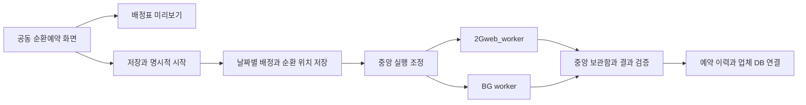

# 공동 키워드 순환예약 개발 설계

13개 키워드를 하나의 목록으로 관리하고, 2Gweb_worker와 BG worker에 하루 최대 2개씩 예약 배정한다. 목록 끝에서는 첫 키워드로 돌아가 계속 순환한다. 날짜별 배정과 실제 실행 결과를 분리하여 수집 공백과 제한 원인을 확인한다.

순환예약 프로그램과 화면을 구현했다. 실제 운영 적용 여부는 배포 기록과 관리자 API의 저장 조건·활성 상태로 구분한다.

2026-10-15 사용자 확정 조건은 2026-10-16부터 09:00·11:00·13:00·15:00(한국시간), 관측일 포함 31일, 상세 1~20위, 데이유즈 유무확인이다. 이 문서 자체는 예약 활성화 증거가 아니다.

## 확정 조건과 설정 항목

| 구분 | 설계 |
|---|---|
| 키워드 목록 | 사용자가 정한 13개 순서 유지 |
| 대상 수집기 | 2Gweb_worker와 BG worker |
| 하루 배정 | 수집기별 2개씩 총 4칸 |
| 반복 | 마지막 키워드 다음에 첫 키워드로 계속 순환 |
| 실행 순서 | 웹 다음 BG 다음 웹 다음 BG |
| 작업 중첩 | 시험 예약 사용 중 중앙 실행 조정기로 겹침 방지 |
| 요청속도 | 각 수집기의 현재 기본속도 유지 |
| 보호와 결과 검증 | 기존 감지와 검증 유지하며 자동 보호 해제 없음 |
| 결과 저장 | 기존 중앙 서버 보관함과 검증된 업체 DB 반영 경로 사용 |
| 미사용 수집기 | 인사이트로 전환된 과거 AWS 수집기를 새 선택지에서 제외 |

예약 배정 시각과 한 수집 작업 안의 HTTP 요청속도는 다른 설정이다. 이 기능에서 HTTP 간격이나 동시 요청 설정을 바꾸지 않는다.

하루 2개는 이번 예약의 기본 배정량이다. 관리자 수동수집의 기존 권한과 수량 정책을 바꾸지 않는다. 화면에는 예약 배정량과 수동 추가 수집량을 구분한다. 배정량 변경 기능은 관리자에게 제공하되 기존 예약에 자동 적용하지 않는다.

하루 전체 배정 칸 수는 중복을 제거한 키워드 수를 넘을 수 없다. 현재 조건은 4칸과 13개이므로 충족한다. 배정량을 늘려 같은 날 목록이 한 바퀴 이상 도는 설정은 저장 전에 거부한다.

## 순환 배정

키워드 순서는 다음과 같다.

경남글램핑, 대구글램핑, 부산글램핑, 경북글램핑, 충남글램핑, 전남글램핑, 전북글램핑, 대전글램핑, 서울근교글램핑, 경주글램핑, 여수글램핑, 가평글램핑, 포천글램핑.

09시, 11시, 13시, 15시는 배정표 설명용 예시다. 실제 시작일과 시각은 예약 등록 화면에서 선택한다.

| 일차 | 웹 09시 | BG 11시 | 웹 13시 | BG 15시 |
|---|---|---|---|---|
| 1일차 | 경남글램핑 | 대구글램핑 | 부산글램핑 | 경북글램핑 |
| 2일차 | 충남글램핑 | 전남글램핑 | 전북글램핑 | 대전글램핑 |
| 3일차 | 서울근교글램핑 | 경주글램핑 | 여수글램핑 | 가평글램핑 |
| 4일차 | 포천글램핑 | 경남글램핑 | 대구글램핑 | 부산글램핑 |
| 5일차 | 경북글램핑 | 충남글램핑 | 전남글램핑 | 전북글램핑 |

정상적으로 매일 배정되면 각 키워드는 3일 또는 4일 간격으로 관측된다. 13일 동안 52칸을 배정하면 각 키워드는 총 4회, 수집기별 2회씩 돌아간다. 이는 배정 규칙의 계산 결과이며 네이버 정상 수집을 보장하는 수치는 아니다.

순환 위치는 성공 횟수가 아니라 **마지막으로 저장한 배정 위치**를 기준으로 한다. 하루 배정 4칸과 다음 순환 위치를 한 번에 영속 저장한다. 같은 날짜의 재조회나 서버 재시작으로 배정표를 다시 만들지 않는다.

실패하거나 미실행된 칸은 해당 날짜에 그대로 남긴다. 빈칸을 다른 키워드로 자동 충원하지 않는다. 그 키워드는 다음 순환에서 다시 배정되며, 별도 보충 수집은 명시적인 작업으로 구분한다. 계획이 일시정지된 날짜에는 새 배정도 순환 위치 전진도 하지 않는다.

## 설정 화면

수집 메뉴의 기존 워커 카드 위에 접을 수 있는 **공동 순환예약** 패널을 추가한다. 기존 워커별 즉시수집과 개별 예약 설정은 유지한다.

패널은 다음 순서로 구성한다.

1. 현재 상태와 다음 배정 키워드, 수집기, 날짜와 시각.
2. 키워드 목록과 목록 개수. 기존 정책 불러오기는 버튼 클릭으로만 처리한다.
3. 대상 수집기와 수집기별 하루 배정량. 기본 대상은 웹과 BG이며 기본 배정량은 각각 2개다.
4. 수집 시작일, 첫 시작시각, 키워드 사이의 시작 간격. 뒤 시각은 자동 계산한다.
5. 숙박 조회기간, 기본 또는 상세 수집, 상세 순위, 데이유즈 방식.
6. 날짜별 배정표와 키워드별 최근 관측일.
7. 배정표 미리보기, 조건 저장, 순환예약 시작, 일시정지 버튼.

속도와 인원 입력란은 추가하지 않는다. 인원은 기존 성인 2명 기준을 사용한다. 숙박기간과 상세 순위는 등록 전 반드시 화면에 명시하며, 과거 정책의 값을 새 계획에 임의로 덮어쓰지 않는다.

미리보기는 향후 7일을 기본으로 보여준다. 표에는 날짜, 시각, 수집기, 키워드, 숙박 조회기간, 예정 또는 실제 상태를 표시한다. 편집안, 서버 저장본, 실행 중 계획을 구분한다. 늦게 도착한 미리보기 응답이 새 편집안을 덮어쓰지 않도록 요청 순서를 검사한다.

수집 시작일과 숙박 조회기간은 별도 항목이다. 기본은 실제 관측일을 포함한 향후 선택 일수다. 예를 들어 10월 20일에 실행하는 14일 수집은 10월 20일부터 11월 2일까지의 숙박일을 조회한다. 늦게 실행했다고 과거 관측 시점의 자료로 표시하지 않는다.

## 저장과 활성화

미리보기, 저장, 활성화를 분리한다.

| 동작 | 결과 |
|---|---|
| 배정표 미리보기 | 입력값으로 계산만 수행하고 설정과 배정 이력은 변경하지 않음 |
| 조건 저장 | 비활성 설정을 저장하며 수집을 시작하지 않음 |
| 순환예약 시작 | 충돌과 수집기 상태를 확인한 뒤 저장한 계획을 활성화 |
| 일시정지 | 이후 미시작 작업을 막고 이미 실행 중인 작업은 결과 저장까지 마무리 |
| 재개 | 보호와 미확정 실행 기록을 검토한 뒤 명시적으로 활성화 |

선택한 수집기에 기존 개별 반복예약이 켜져 있으면 공동 순환예약 시작을 거부하고 해당 예약을 안내한다. 기존 예약을 자동으로 끄거나 삭제하지 않는다. 공동 순환예약을 사용하는 동안 선택 수집기의 별도 반복예약 활성화도 거부한다.

활성 계획은 편집할 수 없다. 일시정지와 진행 작업 종료를 확인한 후 새 설정 개정본을 저장한다. 이전 배정표와 결과는 보존한다. 키워드 순서나 목록 변경 시 다음 배정 키워드를 다시 보여주며, 순환 위치를 조용히 초기화하지 않는다. 기존 키워드가 새 목록에도 있으면 다음 미배정 키워드를 유지하고, 없어졌으면 관리자가 새 시작 위치를 선택한다.

설정 개정이나 켜기와 끄기를 반복해도 이미 배정된 당일 수집기별 2칸을 추가 생성하지 않는다. 날짜별 배정 기록을 여러 개정본에 걸쳐 검사한다. 같은 날짜에 새로운 계획을 겹쳐 실행하지 못하게 한다.

당일 배정이 이미 확정된 뒤 배정량, 대상 수집기, 시각이나 키워드 순서를 변경하면 새 조건은 다음 날 이후부터 적용한다. 확정된 당일 배정표를 다시 계산해서 실행 횟수를 늘리지 않는다.

## 실행 조정

중앙 웹 서버가 배정과 실행 순서를 관리하며, 실제 수집은 지정된 수집기에서 수행한다. 실패 시 다른 수집기로 바꾸지 않는다.

예정 시각은 그 시각 이후 시작할 수 있다는 뜻이다. 실제 시작은 예정 시각, 이전 작업 종료, 직전 실제 시작 이후의 설정 간격을 모두 만족해야 한다. 앞 작업이 지연되면 뒤 작업도 기다리며, 밀린 작업을 간격 없이 연달아 실행하지 않는다.

공동 예약이 사용되는 동안 실제 수집 시작 지점에 중앙 실행 소유권을 둔다. 수동 작업도 예약 수집과 동시에 실행하지 않는다. 이 조정은 작업 중첩만 막으며 워커별 큐, 보호 상태, 결과 이력과 기본속도를 합치지 않는다. 공동 예약을 사용하지 않을 때의 독립 운영 정책은 유지한다.

실행 직전에 다음 상태를 다시 확인한다.

- 지정 수집기의 연결 상태와 퇴역 여부.
- 해당 수집기의 접근 제한 보호와 관리자 보류 상태.
- 모든 수집기의 실제 실행과 유효한 원격 실행 소유권.
- 디스크 여유, 자료 복구 진행 여부, 예약 활성화와 관측일 유효성.
- 당일 중복 실행 여부와 영속 실행 영수증.

원격 수집기의 마지막 연결 시각을 수집 진행으로 표시하지 않는다. 중앙 프로세스가 재시작됐더라도 원격 수집기의 유효한 실행 소유권이 남아 있으면 새 작업을 시작하지 않는다.

원격 수집기 미접속으로 실행 소유권을 무한 점유하지 않는다. 연결 확인과 작업 인수 대기에 유한한 제한을 두고, 한도를 넘으면 미실행 또는 검토 필요 상태로 보류한다. 구체적인 제한시간은 기존 폴링과 인수 시간을 측정해 구현 시 정한다.

## 실패와 공백 처리

| 상황 | 해당 항목 | 공동 순환예약 | 다른 수집기의 보호 |
|---|---|---|---|
| 정상 완료 | 새 수집 완료 | 다음 예정 칸으로 진행 | 변경 없음 |
| 같은 워커의 당일 정상 자료 재사용 | 기존 자료 사용과 원래 관측시각 표시 | 해당 배정 칸 처리 후 진행 | 변경 없음 |
| 정상 응답의 예약 0건 | 정상 자료에 0건 표시 | 정상 검증 결과에 따라 진행 | 변경 없음 |
| 오류나 누락 | 실패 또는 일부 완료 | 확인을 위해 일시정지 | 변경 없음 |
| 접근 제한이나 캡차 | 차단 결과 보존 | 미시작 작업을 보류하고 일시정지 | 제한된 워커만 기존 보호 적용 |
| 실행 여부 불명확 | 결과 확인 필요 | 일시정지하고 자동 재실행 금지 | 변경 없음 |
| 같은 날 앞 작업 지연 | 대기와 지연 사유 표시 | 실제 종료와 간격을 기다림 | 변경 없음 |
| 자정을 넘긴 미시작 항목 | 미실행과 관측 공백 표시 | 전날 작업을 다음 날 몰아서 실행하지 않음 | 변경 없음 |
| 사용자가 일시정지 | 이후 칸은 미실행 또는 보류 | 새 날짜 배정도 멈춤 | 변경 없음 |

실패는 해당 배정에 남기고 자동 재시도하지 않는다. 재개는 결과 기록과 보호 상태를 검토한 뒤 다음 미배정 위치에서 진행한다. 실패 항목을 재수집하려면 별도의 명시적 실행으로 남긴다.

HTTP 200 자체를 성공이나 차단으로 판정하지 않는다. 정상 데이터, 업무 오류, 요청량 제한, 캡차, 통신 실패를 응답과 검증 결과로 구분한다. 오류나 누락으로 생긴 0을 정상 예약 0건으로 처리하지 않는다.

## 중복과 결과 보관

현재 워커별 독립 정책을 유지한다. 같은 워커의 같은 관측일, 키워드, 수집 범위에 대해 진행 공유와 검증된 완료 결과 재사용을 판단한다. 다른 워커의 자료로 해당 수집기의 시험을 실행한 것처럼 성공 처리하지 않는다.

공동 배정표에서는 같은 날 같은 키워드를 중복 배정하지 않는다. 목록의 중복은 저장 전에 표시하고 제거할 항목을 확인한다. 서로 다른 키워드에서 같은 업체가 나와도 키워드별 검색 순위는 각각 보관한다. 업체 DB 통합과 매출 중복 제거는 기존 자료 가공 규칙에서 처리하며, 이 예약 기능이 원본 수집을 합치거나 덮어쓰지 않는다.

기존 자료를 사용한 배정은 새 HTTP 요청 시험과 구분한다. 원래 수집기, runId, 관측시각과 수집 조건을 표시한다. 불완전하거나 차단된 결과는 정상 자료로 재사용하지 않는다.

모든 원본은 기존 중앙 결과 보관함에 보존한다. 품질 검증을 통과한 자료만 기존 업체 DB 반영 경로로 보낸다. 예약 항목에서 보관함 결과와 업체 DB로 바로 이동할 수 있게 한다.

## 실행 기록과 순환 위치 저장

중앙 서버의 영속 데이터 디렉터리 `config/collection-rotation.sqlite`에 예약 전용 SQLite 저장소를 둔다. 기존 예약 파일, 원본 결과와 업체 DB는 이 기능 때문에 재작성하지 않는다. 배정표와 순환 위치는 하나의 트랜잭션으로 저장한다.

| 기록 | 주요 내용 |
|---|---|
| 계획과 개정본 | 키워드 순서, 수집기, 배정량, 시간, 숙박 조회조건, 활성 상태 |
| 날짜별 배정 | 한국시간 날짜, 시작 순환 위치, 배정한 항목, 다음 순환 위치 |
| 항목 | 수집기, 키워드, 예정시각, 상태, 실제 시작과 종료, runId |
| 실행 영수증 | 중복 방지 키, 인수 여부, 실행과 결과 확인 상태 |
| 상태 변경 이력 | 저장, 시작, 일시정지, 실패, 재개, 변경 사유 |

당일 배정표 생성과 순환 위치 갱신은 하나의 트랜잭션으로 저장한다. 같은 날짜와 같은 슬롯을 중복 생성하지 않는다. 수집 요청 전 영수증을 먼저 남긴다. 요청 응답을 받지 못해도 새 요청 번호를 만들어 재전송하지 않고 기존 영수증과 보관함을 조회한다.

서버가 재시작되면 저장된 배정과 영수증을 읽는다. 실행 중이었던 항목은 중앙 상태만으로 실패나 성공을 단정하지 않는다. 원격 작업과 저장 결과를 대조하고, 불명확하면 검토 필요 상태로 남긴다.

현재 구현은 재시작 당시 실행 중 영수증을 `uncertain`으로 보존하고 자동 재개를 막는다. 해당 영수증을 원격 작업·기존 결과와 대조해 해결하는 관리자 복구 기능은 별도 개발 대상이며, 결과 파일 존재만으로 완료 처리하지 않는다. 미인수 취소가 확인된 작업은 `paused`로 구분하여 미확정 실행으로 오인하지 않는다.

## 상태와 관리자 화면

계획 상태는 예약 꺼짐, 예약 대기, 진행 중, 일시정지, 확인 필요로 구분한다. 계속 순환하므로 모든 항목이 한 번 완료됐다는 이유로 계획을 종료하지 않는다.

배정 항목에는 예정, 대기, 수집 중, 새 수집 완료, 기존 자료 사용, 일부 완료, 실패, 접근 제한, 미실행, 결과 확인 필요를 표시한다. 예정시각과 실제 시작시각을 나란히 보여준다.

화면 상단에는 오늘 배정 4개와 새 수집, 재사용, 미실행을 각각 표시한다. 실패 횟수와 실제 HTTP 요청량을 혼합하지 않는다. 수동 추가 수집은 별도 집계해 전체 요청량을 검토할 수 있게 한다.

회차별로 실제 수집기, 키워드, 숙박일수, 상세 순위, 실행시간, 관측 HTTP 요청 수, 예약 일정 성공과 실패, 제한 코드, 결과 품질과 runId를 남긴다. 최초 제한 요청의 정확한 operation이 현재 수집기에서 계측되지 않으면 미기록으로 표시한다. 요청별 추가 계측은 수집 엔진의 별도 개선 항목이며, 이 예약 개발이 해당 정보를 이미 확보했다고 표시하지 않는다.

## 개발 구성과 API

현재 `keyword_worker_scheduler.cjs`는 워커별 목록 전체를 반복한다. 공동 순환예약은 별도 조정기로 추가하고 기존 설정과 과거 영수증의 검증 형식은 유지한다.

| 구성 | 책임 |
|---|---|
| 순수 배정 계산기 | 키워드 순서와 슬롯으로 날짜별 미리보기 계산 |
| 공동 예약 조정기 | 배정 저장, 순환 위치, 상태, 일시정지와 재시작 처리 |
| 중앙 실행 조정 | 수동과 예약의 실제 시작 중첩 방지와 원격 실행 상태 확인 |
| 기존 수집 경로 | 지정 수집기 전달, 차단 감지, 품질 검증과 결과 저장 |
| 예약 화면 | 편집안, 저장본, 활성 상태와 배정표 표시 |
| 이력 연결 | 배정과 결과를 기존 수집 이력에서 조회하고 runId 중복 표시 방지 |

관리자 전용 API 초안은 다음과 같다.

| 메서드와 경로 | 동작 |
|---|---|
| GET /api/collection-rotation | 저장 조건, 계획 상태, 오늘 항목, 다음 배정 조회 |
| POST /api/collection-rotation/preview | 입력값을 검증하고 배정표 계산만 수행 |
| PUT /api/collection-rotation | 비활성 조건과 새 개정본 저장 |
| POST /api/collection-rotation/enabled | 명시적 시작 또는 일시정지 |
| GET /api/collection-rotation/history | 기간별 배정과 실행 결과 조회 |

미리보기와 저장에서 수집을 실행하지 않는다. 변경 API는 관리자 인증, 같은 출처와 JSON 형식을 검증한다. 기존 보호 초기화 API를 예약 저장이나 시작에서 자동 호출하지 않는다.

## 검증과 적용 순서

1. 순수 배정 계산과 미리보기부터 구현한다. 13개 목록과 4개 슬롯의 순환을 확인한다.
2. 날짜별 배정과 순환 위치, 영수증 저장을 구현한다. 재시작과 중복 요청을 모의 검증한다.
3. 중앙 실행 조정과 기존 예약의 상호 충돌 검사를 구현한다.
4. 예약 화면, 결과 보관함과 수집 이력 연결을 구현한다.
5. 외부 네이버 요청을 금지한 로컬 검증 후 운영 적용 범위를 별도로 확인한다.

완료 검증에는 다음 항목을 포함한다.

- 13개 목록이 4칸씩 끊김 없이 순환하고 4일차가 포천, 경남, 대구, 부산으로 배정되는가.
- 누락 없는 13일 배정에서 각 키워드가 총 4회, 워커별 2회씩 배정되는가.
- 같은 날 재시작, 일시정지와 재개, 설정 개정으로 하루 배정량이 늘어나지 않는가.
- 미리보기, 단순 조회, 조건 저장만으로 작업이 생성되지 않는가.
- 기존 개별 예약과 동시 활성화되지 않으며 과거 7개 또는 13개 예약 이력을 계속 읽을 수 있는가.
- 수동 작업, 예약 작업과 재시작 후 남은 원격 실행이 실제로 중첩되지 않는가.
- 미접속, 디스크 부족, 자정 경과와 일시정지가 무한 대기나 다음 날 몰아 수집을 만들지 않는가.
- 차단과 부분 결과가 계획만 보류시키고 다른 워커 보호를 함께 바꾸지 않는가.
- 응답 불명확 뒤 재전송하지 않으며 새 수집과 기존 자료 사용을 구별하는가.
- 라이트와 다크 모드, 모바일에서 배정표와 상태를 읽을 수 있는가.

예약 조정과 UI의 기본 적용 대상은 중앙 웹 서버다. 수집 엔진과 요청속도 계약을 바꾸지 않는 범위라면 원격 수집기 재배포는 필요하지 않다. 요청별 진단 계측을 추가하는 경우에는 해당 엔진의 별도 배포 범위를 산정한다.

## 관련 기존 설계

- [키워드별 간격 예약](keyword-hourly-schedule.md)
- [워커별 독립 운영](collector-worker-isolation.md)
- [수집기별 예약 실행 코드](../scripts/keyword_worker_scheduler.cjs)

워커별 독립 보호와 과거 영수증 보존은 위 기존 계약을 따른다. 이 문서는 공동 순환예약을 사용할 때의 배정과 실행 조정을 추가한다.
